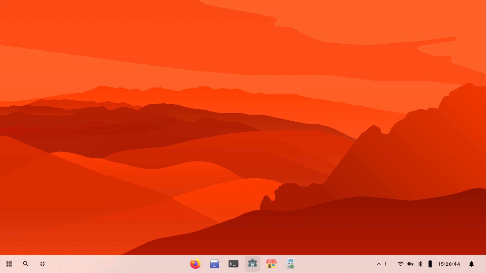
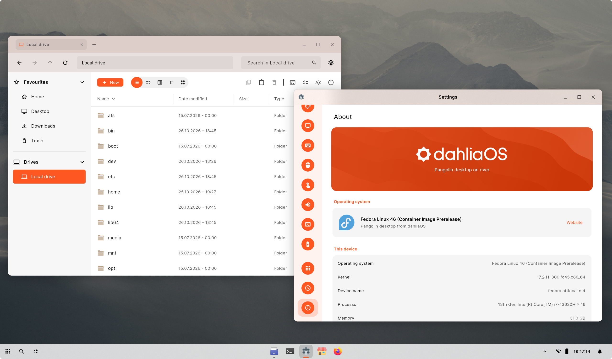

# IMPORTANT: AI-GENERATED FORK DISCLAIMER

> [!WARNING]
> **THIS IS AN UNOFFICIAL FORK.** This project is **NOT associated with, endorsed by, or affiliated with dahliaOS** or the official Pangolin desktop environment.
> 
> **100% AI-GENERATED:** This fork of the Pangolin desktop was entirely brought to life using Artificial Intelligence. I did not write a single line of code, nor am I claiming to. Use entirely at your own risk. 

**DO NOT DEPLOY THIS IN PRODUCTION ENVIRONMENTS!!!!!!!!!!!!!!!!!!!!!!!!!!!!**

***


<p align="center">
  
</p>

> Preview of the Pangolin desktop.
<p align="center">
  
</p>

> Redesigned Files app and Settings.

## Pangolin as a desktop session

Pangolin runs as a full Wayland desktop on a patched
[river](https://codeberg.org/river/river) (0.6 development version, the
non-monolithic river): river composites, handles input and runs the
animations; Pangolin is its window manager and shell, in one Flutter process;
the dahliaOS apps are regular Wayland clients.

### What's included

| Component | What it is |
| --- | --- |
| **river** (`libexec/pangolin/river`) | The compositor, with Pangolin's protocol extensions (blur, window mirrors and animations, layer shell, touchpad gestures) and the wallpaper drawn from its very first frame |
| **Pangolin** (`pangolin`) | Shell (taskbar, launcher, search, Quick Settings, notifications, system tray, overview, lock screen, polkit and Wi-Fi prompts) and window manager, title bars of server-side decorated windows included |
| **dahliaOS apps** (`dahlia_apps <app>`) | Settings, Files, Disks, App Store (Flathub), Clock, Welcome, Terminal, Calculator, Activity Monitor, Gallery, Text Editor, Logs |
| **pangolin-session** | Session launcher: environment, D-Bus, river, autostart, shell supervision |
| **dsettingsd** | The `io.dahlia.DSettings` settings daemon shared by the shell and the apps |
| **pangolin-displays** | Applies the saved monitor layout (or GNOME's `monitors.xml`) at login and when monitors come and go |
| **pangolin-portal** | xdg-desktop-portal backend (file and app choosers); screen sharing goes through xdg-desktop-portal-wlr |
| **pangolin-dm** | Display manager, built like GDM (a daemon, a PAM worker per login); its login screen is the shell in greeter mode, as its own user |

### How it fits together

```
river (patched compositor)
 │  river-window-management-v1 ─▶ Pangolin's window manager (lib/services/wm/river.dart):
 │                                placement, focus, desks, snapping, title bars
 │  river-window-effects-v1    ─▶ mirrors of windows that river animates itself:
 │                                open/close/minimize, the overview, desk slides
 │  river-blur-v1              ─▶ frosted glass, popups opening and closing,
 │                                tints, how much of the shell surface is drawn
 │  river-xkb-bindings-v1, river-touchpad-gestures-v1, river-layer-shell-v1, …
 │
 ├── desktop surface  layer-shell BACKGROUND, transparent (river draws the
 │                    wallpaper): right-click menu, overview backdrop
 ├── shell surface    layer-shell TOP: taskbar, popups, overview; river draws
 │                    only the taskbar's strip until something opens, and clicks
 │                    go through it everywhere else (input region)
 ├── lock screen      ext-session-lock, one surface per monitor
 └── app windows      xdg-shell; X11 apps through Xwayland, started by river
```

* `packages/wayland` is a pure-Dart Wayland client (bindings generated from
  the XML in `packages/wayland/protocols`): the window manager talks to river
  directly from the shell's process, and shares its state with the taskbar,
  overview and launcher.
* The shell's surfaces are Flutter views of one engine (`linux/my_application.cc`,
  gtk-layer-shell, with native helpers in `session/native/` for blur, the
  session lock and password checks). Without a layer-shell compositor, or with
  `--windowed`, Pangolin runs in a normal window using its built-in Utopia
  window manager (handy for development).
* The shell and the apps run on Pangolin's own build of Flutter's Linux
  embedder (`third_party/flutter_engine`): frames follow the display's refresh
  rate instead of a fixed 60 Hz, and only what changed in a frame is
  repainted and reported to river.
* The apps are one Flutter project (`apps/`) built as a multi-call binary; each
  app gets its own Wayland app id (`io.dahliaos.<app>`) and desktop entry.
* Settings live in the `pangolin` dsettings table (scheme extended by
  `packages/pangolin_settings`), so changes made in Settings apply live to the
  shell and every app.
* Several monitors: windows place, snap, maximize and follow their monitor,
  but the shell itself (taskbar, desktop menu, overview) lives on the primary
  monitor only, and desks span all monitors. Per-monitor shell surfaces and
  desks are on the roadmap.

### Requirements

* Flutter (stable) and the Linux desktop toolchain: `clang cmake ninja-build pkg-config libgtk-3-dev`
* `libgtk-layer-shell-dev`, `libxkbcommon-dev`, `libepoxy-dev`, `libwayland-dev`
* river 0.6 (`zig` 0.16, wlroots 0.20, wayland-protocols, libevdev, pixman; see `river-main/river/README.md`):

  ```sh
  cd river-main/river && zig build -Doptimize=ReleaseSafe -Dxwayland --prefix ~/.local install
  ```
* At runtime (optional, features degrade gracefully without them): PAM (lock
  screen), polkit (permission prompts), `wpctl` (volume), `brightnessctl`,
  `flatpak` and PackageKit (App Store), UDisks2 (Disks), `wl-copy` (copying
  screenshots), xdg-desktop-portal-wlr (screen sharing and recording),
  NetworkManager (network and VPN, `nm-connection-editor` to edit VPNs),
  `pw-dump` from PipeWire's tools (screen recording and microphone
  indicators), BlueZ, UPower, power-profiles-daemon, and greetd for the login
  screen of source installs (the Fedora packages use pangolin-dm).
* ARM64, Alpine Linux and other distributions: see
  [docs/PLATFORMS.md](docs/PLATFORMS.md).

### Build and install

```sh
tool/build.sh                 # release builds of river, the shell, the apps and the daemons
tool/install.sh               # installs into ~/.local (use --prefix /usr/local as root)
```

Then start a session:

* from a TTY: `~/.local/bin/pangolin-session`
* inside another desktop, in a window: `~/.local/bin/pangolin-session --nested`
* from a display manager: copy `share/wayland-sessions/pangolin.desktop` from
  the prefix to `/usr/share/wayland-sessions/` (installs to `/usr` or
  `/usr/local` are picked up directly).

`tool/install.sh --uninstall` removes an installation. The session restarts
the shell if it crashes and ends cleanly on **Sign out** (power menu).

Nothing is printed to the console: the session logs to
`/var/log/Pangolin.log` (system-wide installs, writable by the user who ran
`sudo tool/install.sh`) or `~/.local/state/pangolin/Pangolin.log`, and the
login screen to `/var/log/PangolinGreeter.log`. `PANGOLIN_LOG=-` keeps the
output on the terminal.

#### Fedora packages

```sh
tool/dist.sh                  # source tarball: dist/pangolin-desktop-VERSION.tar.xz
tool/rpm.sh                   # RPMs built from it: dist/*.rpm
sudo dnf install dist/pangolin-desktop-*.x86_64.rpm dist/pangolin-desktop-greeter-*.x86_64.rpm
```

`tool/rpm.sh` needs `rpmbuild` (`sudo dnf install rpm-build`, or `sudo apt
install rpm` in a Debian toolbox) besides what `tool/build.sh` needs. The
spec is `packaging/rpm/pangolin-desktop.spec`; `pangolin-desktop-greeter` is
pangolin-dm and the login screen, off until enabled with
`sudo systemctl disable gdm && sudo systemctl enable pangolin-dm`. Pangolin's
river goes to `/usr/libexec/pangolin`, so it doesn't clash with Fedora's
`river` package.

#### Login screen (source installs)

`sudo tool/install.sh --prefix /usr/local --greeter` sets up Pangolin's login
screen for greetd, as GDM does for GNOME:

* it runs as its own user, `pangolin-greeter` (home `/var/lib/pangolin-greeter`),
  with GNOME's Adwaita pointers;
* it shows the wallpaper and font of the selected user and uses the display
  setup of the user who logged in last: sessions share them in
  `/var/lib/pangolin/users` (falling back to `/etc/xdg/monitors.xml`, GNOME's
  configuration);
* it keeps the boot splash on screen until it appears and fades out to black
  when you log in, the desktop then fading in, without showing the text
  console in between;
* the lock screen checks passwords with the distribution's password-only PAM
  stack (`/etc/pam.d/pangolin`), not with the fingerprint reader.

Switch to it with `sudo systemctl disable gdm && sudo systemctl enable greetd`.

#### System-wide

Build as your normal user and only install as root. `pangolin-session` uses
the river installed in its own prefix when there is one, so install river there
too:

```sh
cd river-main/river
DESTDIR="$PWD/stage" zig build -Doptimize=ReleaseSafe -Dxwayland --prefix /usr/local install
sudo cp -r stage/usr/local/. /usr/local/
cd ../..
tool/build.sh --clean           # --clean: first build on this machine
sudo tool/install.sh            # as root the prefix defaults to /usr/local
```

GDM and SDDM list sessions from `/usr/local/share/wayland-sessions`, so
**Pangolin** shows up on the login screen. Remove a per-user install first
(`tool/install.sh --uninstall`): its desktop entries in `~/.local/share` would
shadow the system-wide ones. `sudo tool/install.sh --uninstall` removes the
system-wide install (river's files are separate).

### Keyboard shortcuts

| Shortcut | Action |
| --- | --- |
| <kbd>Super</kbd> / <kbd>Super</kbd>+<kbd>A</kbd> | Launcher |
| <kbd>Super</kbd>+<kbd>S</kbd> / <kbd>Super</kbd>+<kbd>Space</kbd> | Search |
| <kbd>Super</kbd>+<kbd>Tab</kbd> | Overview |
| <kbd>Alt</kbd>+<kbd>Tab</kbd> / <kbd>Alt</kbd>+<kbd>Shift</kbd>+<kbd>Tab</kbd> | Switch windows |
| <kbd>Super</kbd>+<kbd>D</kbd> | Show desktop |
| <kbd>Super</kbd>+<kbd>E</kbd> / <kbd>Super</kbd>+<kbd>T</kbd> / <kbd>Super</kbd>+<kbd>I</kbd> | Files / Terminal / Settings |
| <kbd>Ctrl</kbd>+<kbd>Shift</kbd>+<kbd>Esc</kbd> | Activity Monitor |
| <kbd>Ctrl</kbd>+<kbd>Alt</kbd>+<kbd>Del</kbd> / <kbd>Super</kbd>+<kbd>Shift</kbd>+<kbd>E</kbd> | Power menu (sign out, restart, …) |
| <kbd>Super</kbd>+<kbd>Q</kbd> / <kbd>Alt</kbd>+<kbd>F4</kbd> | Close window |
| <kbd>Super</kbd>+<kbd>↑</kbd> / <kbd>↓</kbd> | Maximize / restore or minimize |
| <kbd>Super</kbd>+<kbd>←</kbd> / <kbd>→</kbd> | Snap to the left / right half |
| <kbd>Super</kbd>+<kbd>Shift</kbd>+<kbd>F</kbd> | Fullscreen |
| <kbd>Super</kbd>+drag / <kbd>Super</kbd>+right-drag | Move / resize a window |
| <kbd>Print</kbd> | Screenshot to `~/Pictures/Screenshots` |

Files and Terminal have tabs: in Files, <kbd>Ctrl</kbd>+<kbd>T</kbd> opens a tab,
<kbd>Ctrl</kbd>+<kbd>W</kbd> closes it, <kbd>Ctrl</kbd>+<kbd>Shift</kbd>+<kbd>T</kbd>
reopens the last closed one, <kbd>Ctrl</kbd>+<kbd>Tab</kbd> /
<kbd>Ctrl</kbd>+<kbd>PgUp</kbd>/<kbd>PgDn</kbd> and <kbd>Alt</kbd>+<kbd>1</kbd>…<kbd>9</kbd>
switch tabs, and middle-clicking a folder (or **Open in New Tab**) opens it in
the background. Tabs can be reordered by dragging. Terminal uses
<kbd>Ctrl</kbd>+<kbd>Shift</kbd>+<kbd>T</kbd> / <kbd>W</kbd> for new / close.

## Development

### Tools

* Flutter, stable (3.47 at the moment), with the Linux desktop toolchain and
  the libraries under [Requirements](#requirements).
* Zig 0.16, for river (`tool/build.sh` builds river only when `zig` is on
  `PATH` or in `ZIG`; a package build without it fails).
* A C compiler and libpam, for the display manager in `dm/`.
* `rpmbuild` for Fedora packages. In a Debian or Ubuntu toolbox on a
  Fedora host, `sudo apt install rpm`; install the packages on the host.

### Where things are

| Path | What |
| --- | --- |
| `lib/` | The shell: taskbar, launcher, overview, Quick Settings, notifications, lock screen, greeter, and the window manager (`lib/services/wm/river.dart`, river's window management protocol) |
| `apps/` | The dahliaOS apps, one multi-call binary (`dahlia_apps <app>`); shared widgets in `apps/lib/kit/` |
| `packages/` | Zenit UI, settings, display configuration, system controls, Wayland bindings |
| `river-main/river/` | river with Pangolin's protocols (blur, animations, gestures) |
| `dm/` | `pangolin-dm`, the display manager ([docs/DISPLAY_MANAGER.md](docs/DISPLAY_MANAGER.md)) |
| `session/` | Session scripts, native code for the Flutter runners, desktop files, icons, PAM, portals |
| `assets/gtk/` | The dahliaOS GTK theme's CSS (`lib/services/gtk_theme.dart` generates it) |
| `third_party/flutter_engine/` | Pangolin's build of Flutter's Linux embedder (high refresh rate, damage), rebuilt with `tool/build_engine.sh` |
| `packaging/rpm/` | The Fedora spec and its files |
| `docs/ROADMAP.md` | What is done, in progress and planned |

### Building and running

```sh
tool/build.sh            # release builds; --debug for debug builds, --clean to start over
tool/install.sh          # into ~/.local
~/.local/bin/pangolin-session --nested    # the whole session in a window of your desktop
```

An app on its own, with hot reload: `cd apps && flutter run -d linux -a files`
(the argument picks the app). The shell needs river, so it runs inside a
session. Logs: `~/.local/state/pangolin/Pangolin.log`, or `PANGOLIN_LOG=-` to
keep them on the terminal; `PANGOLIN_ANIMATION_SCALE=10` slows river's
animations down.

### Tests

```sh
flutter test                         # the shell (test/)
(cd apps && flutter test)            # the apps (apps/test/)
(cd packages/display_config && dart run test/layout_check.dart)
dm/tests/run.sh                      # pangolin-dm, end to end, no root needed
```

### Packages

```sh
FEDORA=45 tool/rpm.sh    # dist/pangolin-desktop-*.rpm and the greeter package
```

Bump `Release:` and add a changelog entry in
`packaging/rpm/pangolin-desktop.spec` for each build you install, so `dnf`
sees it as an upgrade.

### Things to know

* `flutter pub get` rewrites `linux/flutter/generated_plugins.cmake` (and the
  apps' one): don't commit those changes.
* Some build output from the original import is tracked by git
  (`apps/build/`, `river-main/river/zig-out/` and `.zig-cache/`): building in
  place changes it, don't commit that either.
* Anything that starts the apps or services for a test should give them
  their own `XDG_CONFIG_HOME`, `XDG_DATA_HOME` and friends, so they never
  write into your real configuration (a nested session uses yours on
  purpose).

## Contribute

If you're wondering how to contribute to the project, please refer to [CONTRIBUTING.md](/CONTRIBUTING.md)

## Translate

If you're interested in translating Pangolin, click [here](https://github.com/dahliaOS/pangolin_desktop/blob/main/CONTRIBUTING.md#translations) for more information on how to do so!


## License

<p align="left">
  
  
</p>

Copyright @ 2019-2023 - The dahliaOS Authors - contact@dahliaos.io

This fork is licensed under the
[GNU General Public License, version 3](/LICENSE), the license of the river
compositor it ships (`river-main/river`, with Pangolin's changes,
GPL-3.0-only; see its own licensing notes). It is based on dahliaOS's
Pangolin, which is licensed under the Apache 2.0 license
([LICENSE.old](/LICENSE.old)); the files that come from it keep their
Apache 2.0 notices. For forking and redistributing Pangolin, see
[docs/DISTRIBUTING.md](docs/DISTRIBUTING.md).
